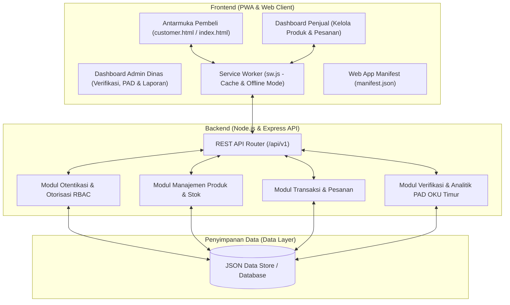
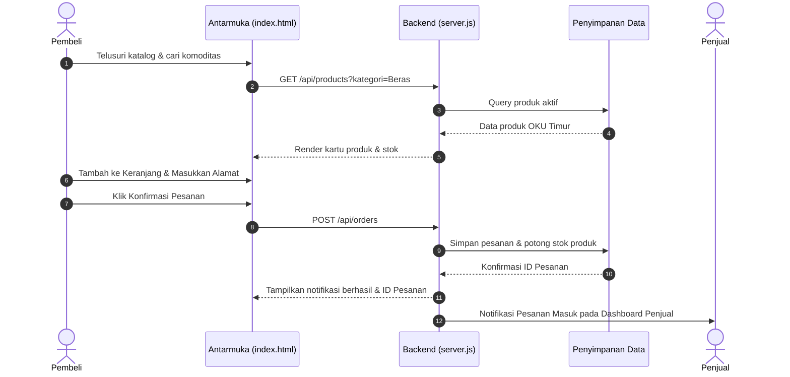

# DOKUMEN DESAIN SISTEM (DESIGN.MD)
## Pasar Tani OKU Timur — Marketplace Pertanian & UMKM Digital

**Mata Kuliah / Bidang:** Perancangan dan Pengembangan Sistem Informasi (PPSI)  
**Target Platform:** Mobile-First Web & Progressive Web App (PWA)  
**Wilayah:** Kabupaten Ogan Komering Ulu Timur (OKU Timur), Sumatera Selatan  
**Versi Dokumen:** 1.0  

---

## 1. Arsitektur Sistem

Aplikasi dibangun menggunakan arsitektur **Client-Server Berbasis PWA (Progressive Web Application)** yang ringan, responsif, dan dapat diakses baik melalui browser smartphone petani/pembeli maupun diinstal langsung ke homescreen perangkat Android/iOS tanpa memerlukan toko aplikasi pihak ketiga.



---

## 2. Palet Warna & Desain UI/UX (Sesuai PRD Seksi 12)

Visual aplikasi dirancang dengan kesan bersih, hangat, dan identik dengan nuansa agrikultur OKU Timur (lumbung pangan Sumatera Selatan):

| Elemen | Kode Warna | Filosofi & Penggunaan |
|---|---|---|
| **Hijau Daun Utama** | `#2E7D32` / `#1B5E20` | Mewakili kesuburan pertanian, tanaman padi, dan dedaunan segar. Digunakan pada Header, Tombol Aksi Utama, dan Navigasi. |
| **Kuning Padi (Aksen)** | `#FBC02D` / `#F57F17` | Mewakili bulir padi matang khas Belitang OKU Timur. Digunakan pada Badge promo, Highlight harga, Rating, dan Notifikasi. |
| **Putih Krem (Latar)** | `#FAFAF7` / `#F5F5F0` | Memberikan kenyamanan visual bagi mata petani dan pembeli di luar ruangan. |
| **Teks Gelap** | `#1E293B` / `#334155` | Memastikan kontras rasio tinggi (WCAG AAA) agar mudah dibaca di bawah sinar matahari. |
| **Status Berhasil** | `#16A34A` | Pesanan selesai, toko terverifikasi. |
| **Status Peringatan** | `#D97706` | Stok menipis (< 5 unit), menunggu verifikasi. |
| **Status Batal/Bahaya** | `#DC2626` | Pesanan dibatalkan, penolakan verifikasi. |

---

## 3. Skema Basis Data & Model Data

### 3.1 Entitas Pengguna (`users`)
```json
{
  "id": "USR-001",
  "nama": "Pak Wayan Sudarma",
  "email": "wayan.belitang@example.com",
  "no_telp": "081234567890",
  "role": "penjual", // "pembeli" | "penjual" | "admin"
  "desa": "Desa Karang Binangun",
  "kecamatan": "Belitang Madang Raya",
  "created_at": "2026-11-01T08:00:00Z"
}
```

### 3.2 Entitas Toko Penjual (`stores`)
```json
{
  "id": "STR-001",
  "user_id": "USR-001",
  "nama_toko": "Tani Makmur Belitang",
  "deskripsi": "Sentra beras ramos organik & produk tani segar langsung dari sawah Belitang.",
  "alamat": "Jalan Raya Belitang BK 10",
  "kecamatan": "Belitang",
  "status_verifikasi": "terverifikasi", // "menunggu" | "terverifikasi" | "ditolak"
  "rating": 4.9,
  "kontak_wa": "6281234567890"
}
```

### 3.3 Entitas Produk (`products`)
```json
{
  "id": "PRD-001",
  "store_id": "STR-001",
  "nama_produk": "Beras Organik Belitang Ramos Super",
  "kategori": "Beras dan hasil pertanian",
  "deskripsi": "Beras pulen tanpa pemutih dan tanpa pengawet dari sawah irigasi teknis Belitang.",
  "harga": 14500,
  "satuan": "kg",
  "stok": 150,
  "stok_minimum": 20,
  "foto": "assets/img/beras-belitang.jpg",
  "is_active": true
}
```

### 3.4 Entitas Pesanan (`orders`)
```json
{
  "id": "ORD-20261103-001",
  "buyer_id": "USR-002",
  "buyer_nama": "Siti Rahmawati",
  "buyer_alamat": "Jl. Merdeka No. 12, Martapura, OKU Timur",
  "buyer_telp": "082199887766",
  "items": [
    {
      "product_id": "PRD-001",
      "nama_produk": "Beras Organik Belitang Ramos Super",
      "harga": 14500,
      "jumlah": 10,
      "subtotal": 145000,
      "store_id": "STR-001"
    }
  ],
  "total_harga": 145000,
  "metode_pembayaran": "COD / Bayar di Tempat",
  "catatan": "Tolong kirim sebelum jam 4 sore",
  "status": "diproses", // "menunggu_konfirmasi" | "diproses" | "dikirim" | "selesai" | "dibatalkan"
  "created_at": "2026-11-03T10:30:00Z"
}
```

---

## 4. Alur Interaksi Sistem (Sequence Diagram)

### Alur Pemesanan Produk oleh Pembeli


---

## 5. Rincian Endpoint REST API

| Method | Endpoint | Deskripsi | Akses |
|---|---|---|---|
| `GET` | `/api/products` | Mengambil seluruh produk atau filter kategori/nama | Publik |
| `GET` | `/api/products/:id` | Mengambil detail spesifik produk & info toko | Publik |
| `POST` | `/api/products` | Menambah produk baru ke etalase | Penjual |
| `PUT` | `/api/products/:id` | Memperbarui detail produk & stok barang | Penjual |
| `DELETE` | `/api/products/:id` | Menghapus atau menonaktifkan produk | Penjual / Admin |
| `GET` | `/api/categories` | Mengambil daftar kategori komoditas pertanian | Publik |
| `GET` | `/api/orders` | Mengambil riwayat pesanan (filter user/toko) | Pembeli / Penjual |
| `POST` | `/api/orders` | Membuat pesanan baru (checkout) | Pembeli |
| `PATCH` | `/api/orders/:id/status`| Memperbarui status pesanan (proses, kirim, selesai) | Penjual / Admin |
| `GET` | `/api/stores/verification` | Menampilkan antrean toko yang butuh verifikasi | Admin Dinas |
| `PATCH` | `/api/stores/:id/verify` | Menerima atau menolak verifikasi toko | Admin Dinas |
| `GET` | `/api/admin/analytics` | Ringkasan transaksi, produk aktif, estimasi PAD | Admin Dinas |

---

## 6. Fitur PWA (Progressive Web App)
- **Manifest (`manifest.json`):** Berisi metadata nama aplikasi, ikon beresolusi tinggi, tema warna hijau `#2E7D32`, dan tautan langsung (shortcuts) ke menu belanja dan dashboard.
- **Service Worker (`sw.js`):** Menyimpan cache App Shell (HTML, CSS, JS, Icon) sehingga aplikasi tetap dapat dibuka saat jaringan lemah atau offline di area persawahan.
- **Installable Banner:** Memungkinkan pengguna memasang aplikasi langsung ke layar utama smartphone seperti aplikasi native Android.

